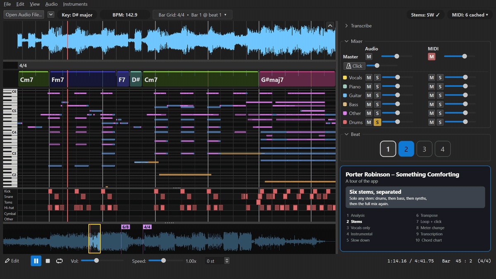
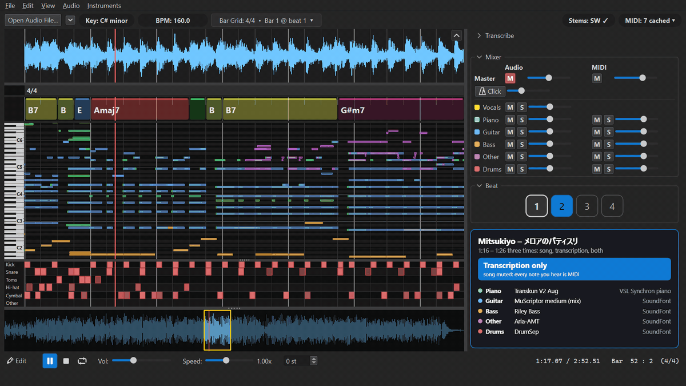
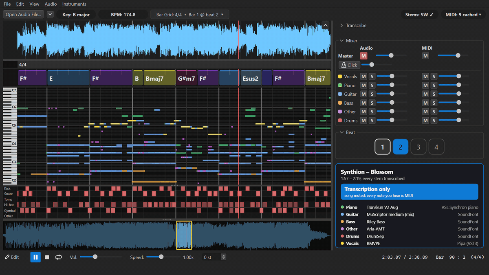
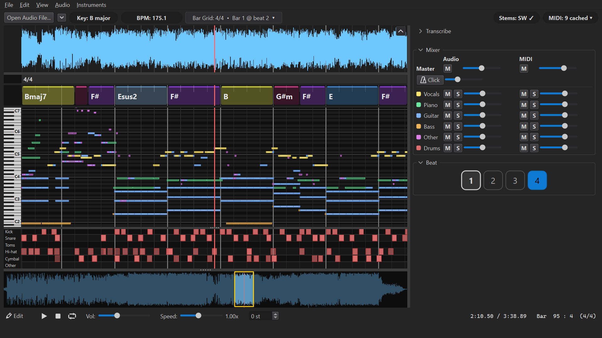
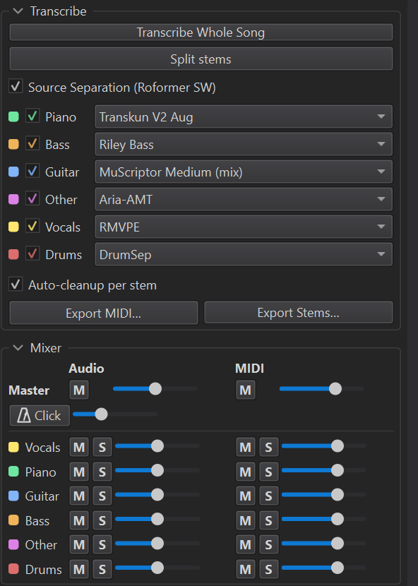
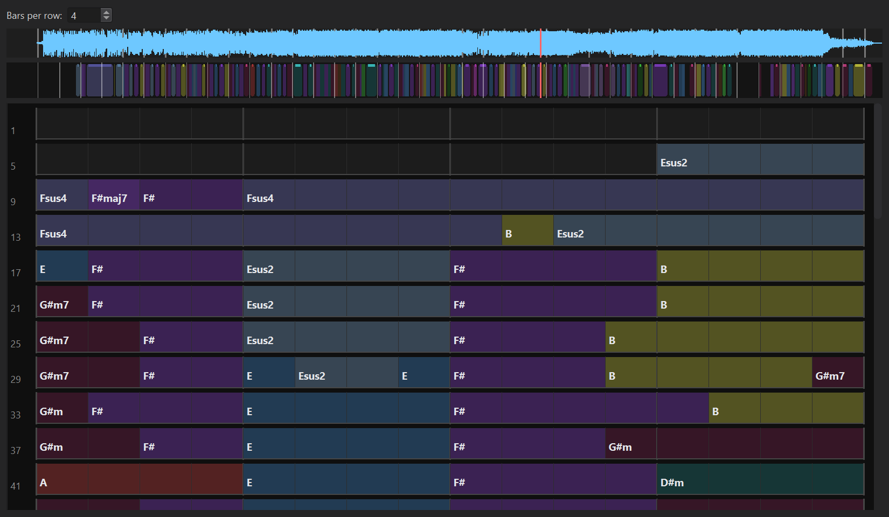

# Song Analyzer

A Windows desktop app for piano transcribers and arrangers. Open a song and it works out the key, tempo, time signature, beats and chords, splits the song into six instruments, and transcribes each one to editable MIDI with a model chosen for that instrument. A native audio engine plays the song and the MIDI together, slowed down, transposed or looped, under a waveform, a chord strip and a piano roll that share one timeline.

Everything runs locally on the user's machine.

> **The source code is private.** This repo is a showcase: what the app does, how it is built, and how I evaluate it.

## Demos (with sound)

All three videos were recorded from the running app: every frame is the real window, and the sound is the app's own audio engine output, the same mix it sends to the speakers. A card in the side panel says what you are watching.

### Feature tour

https://github.com/user-attachments/assets/0814459d-3e0e-421d-a132-907bd8210922

**[▶ Watch the feature tour with sound (1 min 43 s, MP4)](assets/feature-tour.mp4)**

Porter Robinson, *Something Comforting*, in ten short scenes that cross-fade from one part of the song to the next:

1. **Analysis**: key, tempo, beats, bars and chords, detected automatically.
2. **Stems**: the drums, bass and synths soloed one after another, then the full mix.
3. **Vocals only**: the vocal stem soloed, an a cappella.
4. **Instrumental**: the vocal stem muted, a backing track.
5. **Slow down**: 1x, 0.75x, then 0.5x while it plays, at the same pitch.
6. **Transpose**: up two semitones live; the key and chord names follow.
7. **Loop and metronome**: a two-bar loop with a click that follows the song's own beats.
8. **Meter change**: the bar grid follows the song from 4/4 into 6/8.
9. **Transcription**: the song muted, so only the app's MIDI plays.
10. **Chord Overview**: the whole song as a chord chart that follows playback.

### Transcription accuracy

| Mitsukiyo, *メロアのパティスリ* (1:16 to 1:26) | Synthion, *Blossom* (1:57 to 2:19) |
|---|---|
|  |  |
| **[▶ Watch with sound (31 s, MP4)](assets/transcription-demo-melo.mp4)**: the same ten seconds three times, as the original, as the transcription alone, then both together. | **[▶ Watch with sound (24 s, MP4)](assets/transcription-demo-blossom.mp4)**: one take that switches from the original to the transcription alone, then to both. |

https://github.com/user-attachments/assets/6abfafea-8874-4c73-bd4b-30607921b706

https://github.com/user-attachments/assets/550a5039-ad21-4dc5-ad79-1f5da22ab735

Every instrument was separated and transcribed by the app, with no hand correction. *Transcription only* means the song is muted: every note you hear is MIDI the app wrote, played through virtual instruments. *メロアのパティスリ* is instrumental, so it has no vocal part.

| Instrument | Transcribed by | Played back through |
|---|---|---|
| Piano | Transkun V2 Aug | Vienna Synchron Pianos (VST3) |
| Guitar | MuScriptor medium, from the full mix | General MIDI SoundFont |
| Bass | Riley Bass | General MIDI SoundFont |
| Other | Aria-AMT | General MIDI SoundFont |
| Drums | DrumSep (kick, snare, toms, hi-hat, cymbals) | General MIDI SoundFont |
| Vocals | RMVPE pitch tracking, segmented into notes | Pipa (VST3) |

The feature tour's transcription scene uses the same engines and instruments.

## Screenshots

| Transcribe panel: an engine per instrument | Chord Overview |
|---|---|
|  |  |

## What it does

**Analysis**
- Key, with key changes; tempo as a curve, with tempo changes; time signatures, including meter changes and compound meters such as 6/8.
- Beats and downbeats from a neural tracker (Beat This!), and a bar grid derived from them.
- A chord for every beat: chroma templates with a key prior, or the BTC transformer (170 chord types).
- Fixing it by hand: a Bar Grid popover overrides the beat pulse (half or double time), the time signature and where bar 1 starts, and the app re-derives bars and tempo in about half a second. Chords can be changed or auditioned, and edits are remembered per song.

**Transcription**
- Source separation into six stems (vocals, drums, bass, piano, guitar, other) with BS-RoFormer or Demucs, and the drum stem further into kit pieces.
- A table with a transcription engine per instrument: Transkun, Aria-AMT, MuScriptor, Basic Pitch, guitar and bass models, two vocal pitch trackers and a drum transcriber. A run covers the whole song or a looped section.
- Per-stem automatic cleanup, instrument-range filtering, and velocities that follow each stem's loudness passage by passage.

**Editing**
- An Edit mode for the piano roll: select, draw and erase tools, a snap grid that follows the song's real beats, quantize, a velocity lane and drum lanes.
- One-click cleanup: hand split, quantize, snap onsets to beats, remove ghost notes, extract the melody, simplify to chord voicings.
- Undo and redo for every kind of edit (notes, cleanup, chords, bar grid), one history per song.

**Playback**
- A native C++ audio engine: pitch-preserving slowdown (0.25x to 2x) and transpose (±12 semitones) apply instantly while playing, with no re-render.
- A mixer with mute, solo and a fader for each instrument's audio and for its MIDI.
- MIDI plays live through a built-in synth and drum kit, a SoundFont, or VST3 instruments: one plugin instance per instrument, with the plugin's own editor window.
- Looping that snaps to bars, and a metronome that follows the detected beats rather than a fixed tempo.

**Export and workflow**
- MIDI with the tempo map, time signatures and key, so the bar lines land on the real bars in MuseScore or a DAW; one file per instrument; loop-only.
- Separated stems as audio, optionally with the current speed and transpose applied.
- Several songs open at once in tabs, and a folder queue that analyses and transcribes a whole folder in the background.

## How it is built

- **Stack:** Python 3.12 and PyQt6 with custom-painted widgets; a native C++ audio engine (about 9,000 lines: PortAudio, Signalsmith Stretch and Rubber Band R3, TinySoundFont, a VST3 host); PyTorch and ONNX Runtime for the models; librosa and pretty_midi.
- **Audio engine:** the GUI posts state changes, and the engine's audio callback does the rest: it mixes the stems, time-stretches them, plays the MIDI through the synths and plugins after the stretcher (so instruments are synthesized at the new speed instead of being stretched), and limits the result. A plugin that crashes is caught and switched off with a notice instead of taking the app down. At normal speed the mixer is bit-exact, tested against frozen hashes from a reference mixer written in Python.
- **Headless pipeline:** analysis, separation and transcription live in a Qt-free core, and the GUI's worker threads are thin adapters over it. The folder queue runs the same pipeline in a child process and hands the GPU back whenever the window needs it. Each run carries its own job object (options, cancel token, notices) instead of global state.
- **Threading:** long jobs run on worker threads, only the main thread touches widgets, and every slot ignores late signals from cancelled workers. The audio callback never blocks, does no I/O and never raises.
- **One time convention:** every public time is in original-song seconds. The engine stretches live, so its output position differs from the song position whenever the speed is not 1x, and the player converts between the two in one place.
- **Caching:** analysis, stems, MIDI and intermediate features are cached on disk under keys derived from the file's *content*, so a renamed song keeps its results. Changing the beat pulse re-runs only the arithmetic after the models (about 0.6 s instead of 3 s).
- **No silent fallbacks:** when a stage falls back (to the CPU, or to a simpler model), the app says so. This came from a real bug: on battery power Windows disconnects the GPU and every stage quietly ran 10x slower.
- **Licence-aware:** a single switch decides which models are offered, so a build can include only backends whose code and weights are permissively licensed. No model weights are committed; each downloads from its owner.
- **Tests:** about 2,650 pytest tests (CPU only, about 45 s in parallel), golden files for the analysis output, and offscreen GUI tests that drive the real main window.

## How it is evaluated

Quality claims come from a benchmark harness, not from impressions:

- A 31-song corpus of real songs, plus labelled datasets for beats, note transcription, vocals and drums.
- A change is adopted only when it wins on a held-out half of the data (a paired confidence interval that excludes zero), and anything that changes a default is then checked by listening to real songs.
- A speedup must not change the output. Running Aria-AMT's decoding loop as a CUDA graph made it 4.7 to 5.1x faster, and it was adopted after its tokens matched the original on all 31 songs.
- These rules exist because they have paid off. A vocal-pitch setting that won on every labelled set was reverted after it regressed on real songs. Another time, a model's MIDI writer was shifting every note, and note count and median duration looked fine while onset F1 was 0.36 instead of 0.95. The lesson was to measure what the user actually sees, which is where the notes sit.

## Built with AI assistance

I built this with [Claude Code](https://claude.com/claude-code). I set the goals, decided what to measure and what to ship, and did the listening checks on real songs. AI agents implemented, investigated and reviewed changes on feature branches, each in its own worktree, with a reviewer agent checking each branch against the project's rules before I merged it.

## Credits

The app builds on excellent open-source models and libraries, including [Beat This!](https://github.com/CPJKU/beat_this), [Demucs](https://github.com/facebookresearch/demucs), [python-audio-separator](https://github.com/nomadkaraoke/python-audio-separator) (BS-RoFormer, DrumSep), [Transkun](https://github.com/Yujia-Yan/Transkun), [Aria-AMT](https://github.com/EleutherAI/aria-amt), [MuScriptor](https://huggingface.co/MuScriptor/muscriptor-medium), [Basic Pitch](https://github.com/spotify/basic-pitch), [Xavier Riley's guitar and bass models](https://huggingface.co/xavriley/midi-transcription-models), RMVPE, [GAME](https://github.com/openvpi/GAME), [BTC](https://github.com/jayg996/BTC-ISMIR19), [Signalsmith Stretch](https://github.com/Signalsmith-Audio/signalsmith-stretch), [Rubber Band](https://breakfastquay.com/rubberband/), [PortAudio](https://github.com/PortAudio/portaudio), [TinySoundFont](https://github.com/schellingb/TinySoundFont) and the [VST3 SDK](https://github.com/steinbergmedia/vst3_public_sdk). Thanks to their authors.

## Contact

Dennis Qin: [LinkedIn](https://www.linkedin.com/in/dennis-qin/) | [GitHub](https://github.com/DipTaken)
